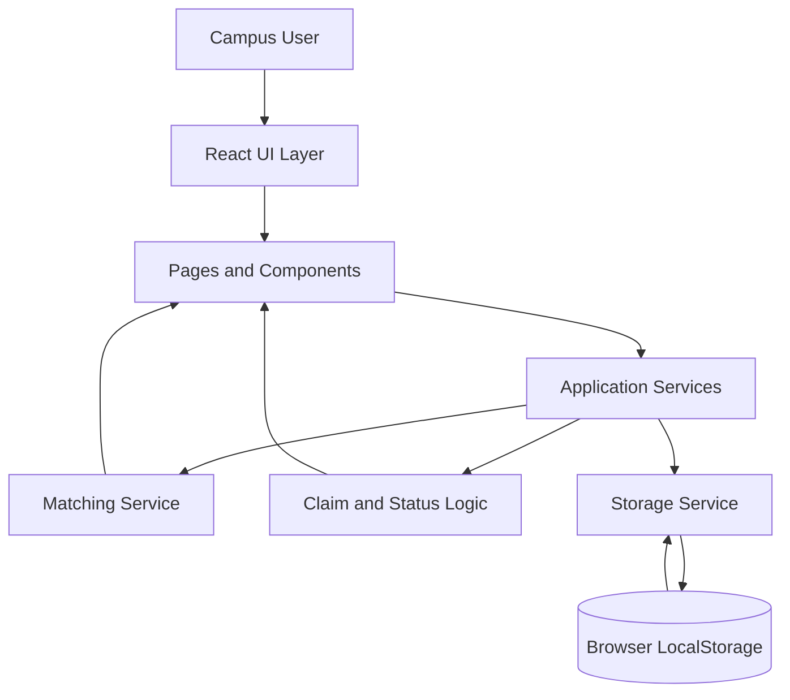
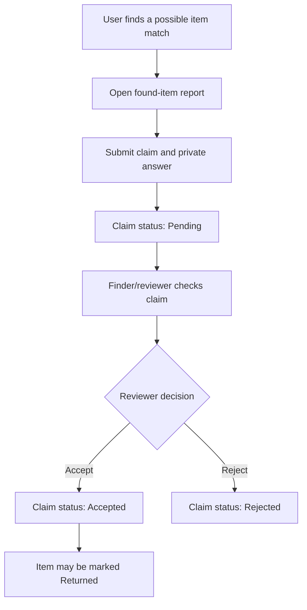

# FindIt — Software Requirements Specification (SRS)

**Project:** FindIt — Smart Campus Lost & Found  
**Event:** JUGAAR JUNCTION 2026 — CUSIT Peshawar  
**Document type:** Software Requirements Specification with Technical Architecture  
**Version:** 1.0  
**Status:** MVP planning baseline  
**Prepared for:** Hackathon project team  
**Implementation target:** Three-hour hackathon MVP  
**Technology baseline:** React, Vite, JavaScript, Tailwind CSS, Lucide React, Browser LocalStorage

---

## Document Control

| Field | Details |
|---|---|
| Project name | FindIt |
| Product tagline | Lost Something? Find It. Found Something? Return It. |
| Document owner | FindIt project team |
| Intended audience | Team members, teacher/advisor, evaluators |
| Primary users | Students, faculty and campus community |
| Deployment target | Local browser demonstration |
| Backend | Not included in MVP |
| Database | Not included in MVP; browser LocalStorage is used for demonstration data |

## 1. Introduction

### 1.1 Purpose

This document defines the requirements, scope, architecture, data model, user workflows, interface expectations, and testing approach for FindIt. It provides a shared reference for the team while designing and implementing the hackathon MVP.

### 1.2 Product overview

FindIt is a campus-focused lost-and-found web application. It provides one place where a campus community member can report an item as lost or found, browse reports, search for relevant items, view possible lost/found matches, and demonstrate a private ownership-claim workflow.

The MVP is a prototype intended to demonstrate the complete concept in a controlled browser environment. It is not a production campus-wide service.

### 1.3 Problem statement

Lost-item information is often shared informally through friends, class groups, messaging applications, or campus offices. These channels are fragmented, difficult to search, and may not connect the person who lost an item with the person who found it. A person claiming an item also needs a way to demonstrate knowledge that is not exposed in the public listing.

### 1.4 Proposed solution

FindIt centralizes lost and found reports in a searchable interface. It compares relevant fields from lost and found reports and suggests possible matches. A separate claim workflow allows a claimant to submit a private identifying clue for review. The match score is a discovery aid only; it is not proof of ownership.

### 1.5 Objectives

- Provide a simple way to submit lost-item reports.
- Provide a simple way to submit found-item reports.
- Make reports searchable and filterable.
- Suggest possible matches between active lost and found reports.
- Keep ownership clues out of public listing views.
- Demonstrate a claim decision and returned-item status.
- Deliver a usable, responsive MVP within the event build window.

### 1.6 Definitions and abbreviations

| Term | Definition |
|---|---|
| MVP | Minimum Viable Product: the smallest demonstrable version |
| Lost report | A record submitted by someone who has lost an item |
| Found report | A record submitted by someone who has found an item |
| Match | A possible relationship between one lost report and one found report |
| Claim | A request by a person who believes a found item belongs to them |
| Private clue | An identifying detail withheld from the public listing |
| LocalStorage | Browser storage available to the current browser profile on the current device |
| UI | User Interface |
| FR | Functional Requirement |
| NFR | Non-Functional Requirement |

## 2. Scope

### 2.1 In-scope MVP features

1. Homepage and primary navigation.
2. Lost-item report form.
3. Found-item report form.
4. Browse listings.
5. Search and basic filters.
6. Possible-match suggestions.
7. Claim submission and simulated review.
8. Mark an item as returned.
9. Persist demonstration records in LocalStorage.
10. Responsive layout for common desktop and mobile viewport sizes.

### 2.2 Out-of-scope features

The following are not required for the hackathon MVP:

- Real user accounts, login, registration, or role-based access.
- A shared remote database or server-side API.
- Real-time synchronization between different users or devices.
- Email, SMS, push, or WhatsApp notifications.
- Live chat between finder and claimant.
- GPS tracking or live maps.
- AI image recognition or image-based similarity.
- Payment processing.
- Production-grade identity verification.
- A full campus administration dashboard.
- Production deployment, monitoring, backups, or service-level guarantees.

### 2.3 MVP assumptions

- The demonstration is performed in one browser profile on one device.
- Users can enter sample information through the interface.
- LocalStorage is used to persist records in that browser.
- A simulated review action is sufficient to demonstrate the claim workflow.
- Users understand that a suggested match is not confirmation of ownership.
- The team will use demonstration data and will not present it as verified real campus data.

### 2.4 Constraints

- The hackathon build window is three hours: 11:30 AM–2:30 PM, according to the event rules supplied to the team.
- The project must be built during the official event window and must not be a pre-built project or existing prototype.
- AI-assisted tools may be used, but team members must understand and explain the submitted work.
- Final pitch slides must be created in Canva.
- The pitch duration is 1–3 minutes.
- The MVP should prioritize a complete working flow over optional complexity.

## 3. Stakeholders and User Classes

| Stakeholder | Role / need |
|---|---|
| Student who lost an item | Submit a lost report and search for a possible recovery |
| Student who found an item | Submit a found report and review a claim |
| Faculty member | Report or search for an item |
| Campus community | Use a common, understandable listing interface |
| Project team | Build, test, explain, and demonstrate the MVP |
| Teacher / evaluator | Review purpose, functionality, design, usability, impact, and presentation |

The MVP does not implement separate permissions for these user classes. User roles describe intended usage, not authenticated system roles.

## 4. User Requirements

- **UR-01:** A user should be able to report an item as lost.
- **UR-02:** A user should be able to report an item as found.
- **UR-03:** A user should be able to browse active reports.
- **UR-04:** A user should be able to search reports using text.
- **UR-05:** A user should be able to filter reports by type or category.
- **UR-06:** A user should be able to see possible matches for a lost report.
- **UR-07:** A claimant should be able to submit a private clue for a found item.
- **UR-08:** A finder should be able to accept or reject a demonstration claim.
- **UR-09:** A user should be able to mark an item as returned.
- **UR-10:** A user should receive clear validation and action feedback.

## 5. Functional Requirements

Functional requirements define what the MVP must do. Requirements marked **Must** are part of the core demonstration.

### 5.1 Navigation and homepage

| ID | Priority | Requirement |
|---|---|---|
| FR-01 | Must | The system shall display a homepage explaining FindIt's purpose. |
| FR-02 | Must | The system shall provide navigation to Home, Report Lost, Report Found, Explore, and Matches. |
| FR-03 | Must | The system shall display clear calls to action for reporting lost and found items. |
| FR-04 | Should | The homepage may display summary counts derived from locally stored reports. |

### 5.2 Lost and found reporting

| ID | Priority | Requirement |
|---|---|---|
| FR-05 | Must | The system shall allow a user to submit a lost-item report. |
| FR-06 | Must | The system shall allow a user to submit a found-item report. |
| FR-07 | Must | Each report shall include an item name, category, colour, location, date, and public description. |
| FR-08 | Must | The form shall validate required fields before saving. |
| FR-09 | Must | The system shall generate a unique identifier for each saved report. |
| FR-10 | Must | The system shall record whether a report is of type `lost` or `found`. |
| FR-11 | Must | The system shall assign a default active status to a newly created report. |
| FR-12 | Should | The form may accept an optional private clue for ownership verification. |
| FR-13 | Should | After successful submission, the system should show confirmation and navigate to a useful view. |

### 5.3 Listings, search, and filters

| ID | Priority | Requirement |
|---|---|---|
| FR-14 | Must | The system shall display saved lost and found reports in a listing view. |
| FR-15 | Must | The system shall visually distinguish lost reports from found reports. |
| FR-16 | Must | The system shall support text search across public item fields. |
| FR-17 | Must | The system shall support filtering by report type. |
| FR-18 | Should | The system should support filtering by category and status. |
| FR-19 | Must | Public listing cards shall not display private ownership clues. |
| FR-20 | Must | The system shall show a useful empty state when no reports match the current search or filters. |

### 5.4 Matching

| ID | Priority | Requirement |
|---|---|---|
| FR-21 | Must | The system shall compare active lost reports with active found reports. |
| FR-22 | Must | The system shall calculate a match score from defined comparison factors. |
| FR-23 | Must | The system shall display possible matches with their score and matching reasons. |
| FR-24 | Must | The system shall not describe a match score as proof of ownership. |
| FR-25 | Should | The system should sort possible matches from highest score to lowest score. |
| FR-26 | Must | The system shall not suggest a report as a match to itself or compare lost reports only with other lost reports. |

### 5.5 Claim and verification demonstration

| ID | Priority | Requirement |
|---|---|---|
| FR-27 | Must | The system shall provide a claim action for an eligible found report. |
| FR-28 | Must | The claimant shall be able to submit a clue or answer for review. |
| FR-29 | Must | The review interface shall allow a simulated accept or reject decision. |
| FR-30 | Must | The system shall record the claim's demonstration status. |
| FR-31 | Must | The system shall keep the private clue out of public item cards and public search results. |
| FR-32 | Must | The interface shall explain that this prototype does not provide secure identity verification. |

### 5.6 Item status and persistence

| ID | Priority | Requirement |
|---|---|---|
| FR-33 | Must | The system shall allow an eligible report to be marked as returned. |
| FR-34 | Must | The system shall update the displayed status after a status change. |
| FR-35 | Must | The system shall save and retrieve MVP records using LocalStorage. |
| FR-36 | Must | The system shall handle missing or invalid stored data without crashing where reasonably possible. |
| FR-37 | Should | The system should provide a reset or clear-demo-data action for controlled demonstrations, with confirmation before deletion. |

## 6. Non-Functional Requirements

| ID | Category | Requirement |
|---|---|---|
| NFR-01 | Usability | Primary actions shall have clear labels and understandable feedback. |
| NFR-02 | Responsiveness | Core screens shall remain usable on common mobile and desktop viewport sizes. |
| NFR-03 | Performance | Search and matching over a small hackathon demonstration dataset should complete without noticeable delay. |
| NFR-04 | Reliability | Invalid form submissions shall not create incomplete reports. |
| NFR-05 | Data persistence | Records shall remain available after refreshing the same browser profile, subject to browser storage availability. |
| NFR-06 | Privacy | Private clues shall not be rendered in public listing cards or public search results. |
| NFR-07 | Security limitation | The MVP shall not claim that LocalStorage provides secure storage or access control. |
| NFR-08 | Maintainability | UI components, storage functions, and matching logic should be separated into understandable modules. |
| NFR-09 | Compatibility | The MVP shall target a modern browser with JavaScript and LocalStorage support. |
| NFR-10 | Explainability | Team members shall be able to explain the matching score, storage behavior, and prototype limitations. |

## 7. Use Cases and Workflows

### 7.1 Use Case UC-01: Report a lost item

**Primary actor:** Person who lost an item  
**Precondition:** The application is open.  
**Main flow:**

1. User selects Report Lost.
2. System displays the lost-item form.
3. User enters the required public item information.
4. User optionally enters a private ownership clue.
5. User submits the form.
6. System validates the required fields.
7. System creates a unique report ID and saves the report.
8. System displays confirmation and makes the report available in the relevant listing.

**Alternative flow:** If required information is missing or invalid, the system displays field-level validation and does not save the report.

**Postcondition:** A lost report is stored in the current browser's LocalStorage.

### 7.2 Use Case UC-02: Report a found item

**Primary actor:** Person who found an item  
**Precondition:** The application is open.  
**Main flow:**

1. User selects Report Found.
2. System displays the found-item form.
3. User enters the required item information.
4. User optionally enters a private clue or identifying detail.
5. User submits the form.
6. System validates and saves the report.
7. System displays confirmation.

**Postcondition:** A found report is stored in the current browser's LocalStorage.

### 7.3 Use Case UC-03: Explore reports

**Primary actor:** Campus community member  
**Main flow:**

1. User opens Explore.
2. System displays available reports.
3. User enters a search term or selects a filter.
4. System updates the visible results.
5. User opens a relevant report for available actions.

**Alternative flow:** If no report matches, the system displays an empty state and allows the user to clear the search or filters.

### 7.4 Use Case UC-04: View possible matches

**Primary actor:** Person who lost an item  
**Main flow:**

1. User opens Matches or a lost report's match view.
2. System compares the selected active lost report with active found reports.
3. System calculates scores and reasons.
4. System displays candidate matches in descending score order.
5. User reviews the candidate information.

**Postcondition:** The user sees suggestions; no ownership decision is made by the matching algorithm.

### 7.5 Use Case UC-05: Submit and review a claim

**Primary actors:** Claimant and finder (represented through a simulated review interface)  
**Main flow:**

1. Claimant selects an eligible found report.
2. System displays the claim form.
3. Claimant submits the requested clue or answer.
4. System records a pending demonstration claim.
5. Finder/reviewer opens the claim review view.
6. Reviewer accepts or rejects the claim.
7. System updates the claim status and provides feedback.

**Important limitation:** In the MVP, the claimant and reviewer may be represented by actions in the same browser. This is a demonstration workflow, not a secure multi-user approval process.

### 7.6 Use Case UC-06: Mark an item as returned

**Primary actor:** Finder/reviewer in the demonstration  
**Main flow:**

1. User opens an eligible report.
2. User selects Mark as Returned.
3. System updates the report status.
4. System removes or distinguishes the report from active results.
5. System displays the updated status.

## 8. System Architecture

### 8.1 Architecture style

The MVP uses a client-side, component-based architecture. React renders the interface, JavaScript modules implement application logic, and browser LocalStorage persists demonstration data.

There is no application server, REST API, or remote database in the MVP.

### 8.2 Logical architecture



### 8.3 Layer responsibilities

| Layer / module | Responsibility |
|---|---|
| UI layer | Displays pages, forms, cards, navigation, feedback, and responsive layouts |
| Components | Reusable interface elements such as Navbar, ItemCard, SearchBar, and StatusBadge |
| Pages | Compose components into Home, Report, Explore, Matches, and Claims views |
| Application logic | Coordinates form submission, filtering, claim actions, and status changes |
| Matching service | Compares lost and found reports and returns scores with reasons |
| Storage service | Reads, writes, updates, and removes LocalStorage records |
| Data layer | Stores serialized demonstration records in the current browser |

### 8.4 Suggested source-code structure

```text
FindIt/
├── docs/
│   ├── SRS.md
│   └── DEVELOPMENT_LOG.md
├── public/
├── src/
│   ├── components/
│   │   ├── Navbar.jsx
│   │   ├── Footer.jsx
│   │   ├── ItemCard.jsx
│   │   ├── SearchBar.jsx
│   │   └── StatusBadge.jsx
│   ├── pages/
│   │   ├── Home.jsx
│   │   ├── ReportLost.jsx
│   │   ├── ReportFound.jsx
│   │   ├── Explore.jsx
│   │   ├── Matches.jsx
│   │   └── Claims.jsx
│   ├── utils/
│   │   ├── matching.js
│   │   ├── storage.js
│   │   └── validation.js
│   ├── App.jsx
│   ├── main.jsx
│   └── index.css
├── index.html
├── package.json
└── README.md
```

The team may simplify this structure if the three-hour time limit requires it. Files should only be added when they support an implemented feature.

### 8.5 Navigation approach

For the MVP, page state in the root App component may be used instead of adding a routing library. If the team has sufficient time and a clear reason, a client-side router may be considered, but it is not required.

## 9. Technology Stack

| Technology | Purpose | MVP usage |
|---|---|---|
| React | UI library | Components and page rendering |
| Vite | Build tool and development server | Project initialization and local development |
| JavaScript ES6+ | Programming language | State, validation, search, matching, and storage logic |
| Tailwind CSS | Utility-first styling | Layout, spacing, typography, responsive behavior |
| Lucide React | Icon library | Consistent interface icons |
| Browser LocalStorage | Browser persistence | Store reports and demonstration claims |
| Git (if available) | Version control | Save incremental working states |

### 9.1 Technology selection rationale

- React supports reusable components and state-driven UI.
- Vite provides a quick development setup.
- JavaScript avoids adding a TypeScript learning/configuration overhead during the short build window.
- Tailwind CSS supports rapid, consistent styling.
- LocalStorage avoids backend setup for a single-browser demonstration.
- Lucide React provides a consistent icon set.

### 9.2 Future production options — not MVP commitments

A future shared campus service could evaluate:

| Area | Possible technology |
|---|---|
| Frontend | React |
| Backend | Node.js with Express |
| Database | MongoDB or another suitable database |
| Authentication | Secure server-managed sessions or an appropriate identity provider |
| Image storage | Cloudinary or equivalent object storage |
| API | REST API |
| Deployment | A suitable frontend and backend hosting platform |

These are options for later evaluation. They are not implemented or required by this SRS's MVP scope.

## 10. Data Model and Storage Design

### 10.1 Item record

The logical item record may use the following fields:

| Field | Type | Required | Visibility / purpose |
|---|---|---:|---|
| id | String | Yes | Unique record identifier |
| type | String (`lost` / `found`) | Yes | Public report type |
| itemName | String | Yes | Public item name |
| category | String | Yes | Public category |
| color | String | Yes | Public colour |
| location | String | Yes | Public campus location |
| date | String | Yes | Date lost or found |
| description | String | Yes | Public description |
| privateClue | String | No | Restricted demonstration field; never show on public cards |
| status | String | Yes | `active`, `claimed`, or `returned` |
| createdAt | String | Yes | Creation timestamp |

Example shape (illustrative only):

```json
{
  "id": "item-example-001",
  "type": "lost",
  "itemName": "Wallet",
  "category": "Accessories",
  "color": "Black",
  "location": "University Library",
  "date": "2026-11-19",
  "description": "Small black wallet with a zip.",
  "privateClue": "A detail known to the owner",
  "status": "active",
  "createdAt": "2026-11-19T12:00:00.000Z"
}
```

This is a data-shape example, not a pre-created hackathon record. Any demonstration records should be entered during the official build window.

### 10.2 Claim record

| Field | Type | Purpose |
|---|---|---|
| id | String | Unique claim ID |
| itemId | String | Related found-item ID |
| submittedClue | String | Claimant's submitted answer |
| status | String | `pending`, `accepted`, or `rejected` |
| createdAt | String | Claim creation timestamp |

The MVP may store claim records locally for demonstration. A production system would require server-side access control and a more carefully designed verification process.

### 10.3 Match result

| Field | Type | Purpose |
|---|---|---|
| lostItemId | String | Lost report being evaluated |
| foundItemId | String | Candidate found report |
| score | Number | Score from 0 to 100 |
| reasons | String array | Factors that contributed to the score |

Match results can be calculated when needed rather than permanently stored.

### 10.4 LocalStorage keys

Suggested keys:

- `findit_items`
- `findit_claims`

Storage module responsibilities:

- `getItems()` — read and parse item records.
- `saveItems(items)` — persist the item collection.
- `addItem(item)` — append a new report.
- `updateItemStatus(id, status)` — update a report's status.
- `getClaims()` — read claim records.
- `addClaim(claim)` — add a demonstration claim.
- `updateClaimStatus(id, status)` — update the claim decision.

The implementation should handle JSON parsing errors and unavailable storage gracefully.

### 10.5 LocalStorage limitations

LocalStorage is scoped to a browser origin and browser profile. It does not synchronize data to another person's device. It is not a secure database: users with access to the browser can inspect or modify its contents. Therefore, private clues in this prototype are hidden from the public UI but are not protected against a technically capable person using browser developer tools. Do not use real sensitive information in the demonstration.

## 11. Matching Algorithm

### 11.1 Purpose

The matching service helps users discover potentially related reports. It does not establish ownership and must not automatically accept a claim.

### 11.2 Weighted scoring model

| Factor | Weight | Comparison |
|---|---:|---|
| Category | 30 points | Exact category match |
| Colour | 25 points | Normalized colour match |
| Location | 25 points | Exact or normalized location match |
| Description keywords | 20 points | Proportion of meaningful shared keywords |
| **Total** | **100 points** | |

### 11.3 Algorithm steps

1. Select one active lost report.
2. Retrieve active found reports.
3. Compare each found report with the selected lost report.
4. Normalize text by trimming whitespace and comparing without case sensitivity.
5. Award points for each matching factor.
6. Collect human-readable reasons for the score.
7. Return candidate matches sorted by score, highest first.
8. Display a clear notice that results are suggestions only.

### 11.4 Pseudocode

```text
function findMatches(lostItem, foundItems):
    candidates = []

    for each foundItem in foundItems:
        if foundItem.type is not "found":
            continue

        if foundItem.status is not "active":
            continue

        score = 0
        reasons = []

        if categories match:
            score += 30
            add category reason

        if colours match:
            score += 25
            add colour reason

        if locations match:
            score += 25
            add location reason

        keywordScore = calculateDescriptionSimilarity(...)
        score += keywordScore (maximum 20)

        if score is above 0:
            add candidate with score and reasons

    sort candidates by score descending
    return candidates
```

### 11.5 Matching safeguards

- Only compare lost reports with found reports.
- Exclude non-active reports from new suggestions.
- Do not include private clues in the matching score or public reasons.
- Do not label any score as verified ownership.
- A high score must not automatically change an item's status.
- The UI should show why a candidate was suggested.

## 12. Ownership Claim and Verification Workflow

### 12.1 Workflow



### 12.2 Rules

- Private clues must not appear in public listings.
- The claimant's answer must be submitted through a separate claim action.
- The demo reviewer explicitly accepts or rejects the claim.
- An accepted demonstration claim may enable the returned status action.
- A match score cannot replace the claim workflow.

### 12.3 Prototype limitation

The MVP has no real user identities, authentication, or separate devices. The reviewer action is simulated within the same browser. This is a demonstration workflow, not a secure multi-user approval process.

## 13. User Interface and UX Requirements

### 13.1 Required screens

| Screen | Main content | Main actions |
|---|---|---|
| Home | Product explanation, main actions, summary counts | Report Lost, Report Found, Explore |
| Report Lost | Lost-item form | Submit report |
| Report Found | Found-item form | Submit report |
| Explore | Report cards, search and filters | Search, filter, open report |
| Matches | Candidate match cards, score and reasons | Review possible match |
| Claims | Claim submission/review demonstration | Submit, accept, reject |
| Item detail (optional) | Full public item information and status | Claim or mark returned when eligible |

### 13.2 Design direction

- Product style: modern, trustworthy, campus-focused.
- Primary colour: deep navy `#142B4A`.
- Action blue: `#2563EB`.
- Success green: `#10B981`.
- Page background: `#F1F5F9`.
- Typography: Inter or a clean sans-serif fallback.
- Use clear spacing, readable headings, consistent cards, and visible form labels.
- Use responsive layouts and accessible colour contrast.
- Do not rely on colour alone to communicate lost/found/claim status.

### 13.3 UX behavior

- Every form field shall have a visible label.
- Required fields shall be clearly indicated.
- Validation messages shall explain how to correct an error.
- Buttons shall use action-specific labels.
- Empty search results shall provide a way to clear filters.
- Destructive demo-data reset actions shall require confirmation.
- Public cards shall never render private clues.

## 14. Validation, Errors, and Edge Cases

The application should handle the following:

- Required field left empty.
- Whitespace-only item name or description.
- Invalid or missing date.
- Search with no results.
- Empty LocalStorage.
- Malformed JSON in LocalStorage.
- Attempt to claim an item that is already returned.
- Attempt to mark an ineligible item as returned.
- Duplicate submission caused by repeated clicks.
- Missing item or claim ID.
- A report with no possible matches.

The interface should show useful feedback and avoid silently failing.

## 15. Security and Privacy Considerations

### 15.1 MVP safeguards

- Do not collect passwords or sensitive identity documents.
- Do not use real private or sensitive ownership clues in sample data.
- Do not render private clues in public item cards or search results.
- Do not claim that the prototype authenticates users.
- Do not claim that LocalStorage protects private data.
- Clearly label the claim and review process as a demonstration.
- Avoid publishing personal phone numbers or addresses in sample records.

### 15.2 Production security requirements for future work

A production system would need, at minimum:

- Server-side authentication and authorization.
- Server-side validation of all submitted data.
- Access control for private clues and claim records.
- Secure transport (HTTPS).
- Rate limiting and abuse prevention.
- Audit logs for claim decisions and status changes.
- Data retention and deletion policies.
- Backup and recovery procedures.
- A privacy notice and clear reporting process.

These are future requirements, not features delivered by the MVP.

## 16. Testing Strategy

### 16.1 Testing approach

Testing will focus on the complete demonstration workflow, data validation, matching correctness, privacy presentation, and persistence after refresh.

### 16.2 MVP test cases

| Test ID | Scenario | Expected result |
|---|---|---|
| TC-01 | Submit a valid lost report | Report is saved and displayed |
| TC-02 | Submit a valid found report | Report is saved and displayed |
| TC-03 | Submit a form with required fields missing | Validation appears; no record is saved |
| TC-04 | Search by an item name | Relevant public results are displayed |
| TC-05 | Filter by lost/found type | Only selected type is displayed |
| TC-06 | Create comparable lost and found reports | A possible match is suggested |
| TC-07 | Compare reports with different categories | Category points are not awarded |
| TC-08 | Open public item cards | Private clue is not displayed |
| TC-09 | Submit a claim | Claim is recorded as pending |
| TC-10 | Accept a demonstration claim | Claim status changes to accepted |
| TC-11 | Reject a demonstration claim | Claim status changes to rejected |
| TC-12 | Mark an eligible item as returned | Item status changes to returned |
| TC-13 | Refresh the same browser | Stored demonstration records remain |
| TC-14 | Search for a nonexistent item | Clear empty state is displayed |
| TC-15 | Attempt an invalid status action | Action is blocked or safely handled |

### 16.3 Acceptance criteria

The MVP is considered ready for demonstration when:

1. The application starts successfully in the development environment.
2. A user can submit both lost and found reports.
3. Reports appear in the listing view.
4. Search and basic filters work.
5. The matching service returns understandable candidate suggestions.
6. The UI communicates that matching is not proof of ownership.
7. A claim can be submitted and accepted or rejected in the demonstration.
8. An eligible item can be marked as returned.
9. Public item views do not display private clues.
10. Data persists after refresh in the same browser profile.
11. The primary workflow can be demonstrated without a blocking error.
12. Team members can explain the architecture and prototype limitations.

## 17. Risks and Mitigation

| Risk | Impact | Mitigation / fallback |
|---|---|---|
| Tailwind setup takes too long | UI development delayed | Use a minimal plain CSS fallback if needed |
| Routing setup consumes time | Integration delay | Use simple page state in App.jsx |
| LocalStorage implementation fails | Data does not persist | Use React state temporarily and explain the limitation |
| Matching logic takes too long | Core differentiator missing | Implement category and colour matching first, then add location and keywords |
| Claim workflow becomes complex | Demo incomplete | Use one pending/accept/reject demonstration flow |
| Team integration conflicts | Broken application | Agree on data fields and function contracts before parallel work |
| Image upload is unreliable | Form/demo delay | Use category icons or a static placeholder; omit uploads |
| Feature scope expands | Incomplete MVP | Freeze optional features and prioritize the complete core workflow |

## 18. Three-Hour Development Plan

| Time | Activity | Expected output |
|---|---|---|
| 11:30–11:45 | Initialize app, install dependencies, agree on data model | Running project and shared interfaces |
| 11:45–12:25 | Build homepage, forms, cards, and navigation in parallel | Core UI |
| 12:25–1:05 | Integrate reporting, LocalStorage, listing, and search | Reports can be created and explored |
| 1:05–1:35 | Implement matching and claim workflow | Core differentiator demonstrated |
| 1:35–1:55 | Test and fix critical issues | Stable end-to-end flow |
| 1:55–2:15 | UI polish, prepare Canva slides, rehearse | Presentation-ready MVP |
| 2:15–2:30 | Freeze features and verify final demo | Final build |

The team should adjust this schedule to the organizer's actual event instructions and should not continue building beyond the permitted window.

## 19. Team Responsibilities

| Role | Primary responsibility | Shared responsibility |
|---|---|---|
| Member 1 — Frontend / integration | App setup, navigation, homepage, shared styling, integration | End-to-end testing |
| Member 2 — Forms / listings | Lost and found forms, item cards, search and filters | Data-model consistency |
| Member 3 — Logic / workflow | Matching, claim workflow, status updates, test cases | Demo preparation and explanation |

All members should understand the overall workflow, not only their assigned files. Agree on the item and claim data structures before parallel implementation.

### 19.1 Suggested function contracts

```text
addItem(item)
getItems()
updateItemStatus(id, status)
findMatches(lostItem, foundItems)
addClaim(claim)
getClaims()
updateClaimStatus(claimId, status)
```

The team should agree on exact argument shapes and return values before parallel implementation.

## 20. Demonstration Plan

### 20.1 Demonstration scenario

Use fictional demonstration data entered during the official build window:

1. A student reports a black wallet lost near the university library.
2. Another user reports finding a similar wallet.
3. FindIt displays a possible match and explains the matching factors.
4. The claimant submits a private clue.
5. The demonstration reviewer accepts the claim.
6. The report is marked as returned.

Do not present this scenario as a real recovery or as proof that the system verifies identity.

### 20.2 Suggested 75–90 second demo

| Time | Demonstration |
|---|---|
| 0–10 seconds | Explain the campus lost-and-found problem |
| 10–25 seconds | Submit a lost report |
| 25–40 seconds | Submit a found report |
| 40–55 seconds | Show the possible match and reasons |
| 55–75 seconds | Submit and review a private-clue claim |
| 75–90 seconds | Mark the item as returned and state the impact |

### 20.3 Presentation requirements

The event rules specify a 1–3 minute pitch and Canva-only final slides. The team should:

- Explain the problem and intended users first.
- Demonstrate the actual working MVP.
- Explain the matching score as a suggestion.
- State the single-browser prototype limitation honestly.
- Describe future potential without claiming unimplemented features.

## 21. Future Enhancements

Potential future development, subject to user research and technical evaluation:

- Secure student and staff authentication.
- Shared backend and central database.
- Multi-device synchronization.
- Administrative moderation tools.
- Email or push notifications.
- Image uploads and image similarity assistance.
- Campus building/location directory.
- Claim audit history.
- Abuse reporting and duplicate-report handling.
- Accessibility improvements and multilingual support.
- Analytics on recovery rates and common lost-item locations.

## 22. Open Decisions

The following decisions can be confirmed with the teacher, team, or users before or during implementation:

1. Whether the university wants a campus-only service or a broader community service.
2. Which campus locations should appear in a location selector.
3. Which item categories are most useful.
4. Whether a finder should be able to contact a claimant directly in a future version.
5. Who would be responsible for moderating disputed claims in a production system.
6. Whether the institution would approve a real deployment and provide an official data/privacy policy.

## 23. Conclusion

FindIt proposes a focused solution to a recognizable campus problem by bringing lost and found reports into one searchable interface. Its MVP demonstrates reporting, discovery, possible matching, a private-clue claim workflow, and return status.

The hackathon version deliberately avoids backend infrastructure and real authentication so the team can prioritize a complete, understandable demonstration within the available build time. Any production deployment would require a shared backend, secure access control, privacy review, and institutional approval.

---

**End of document**

**Implementation reminder:** This SRS is a requirements and design reference. It is not a pre-built application. Follow the hackathon organizer's rules about when planning documents may be prepared, and create the submitted application and demo only within the official build window.
